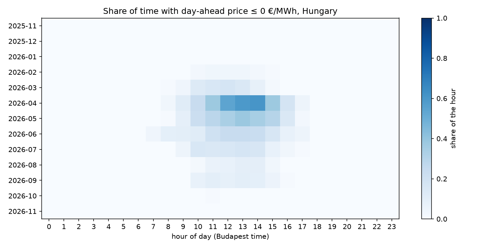
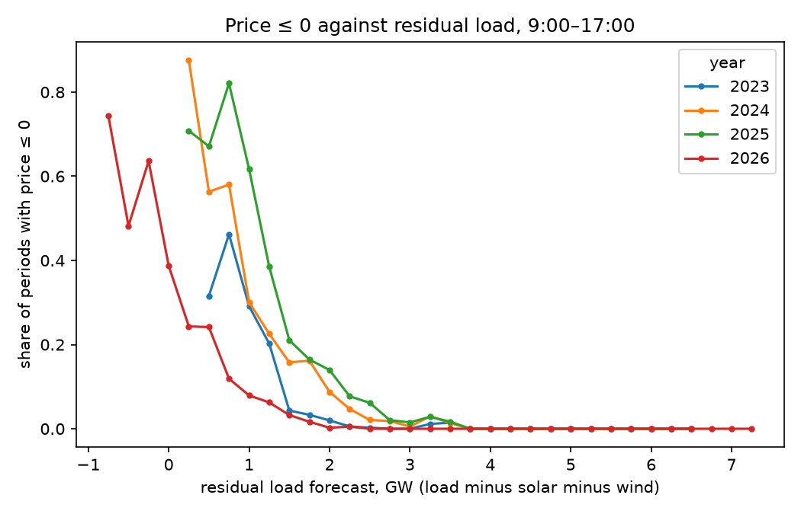
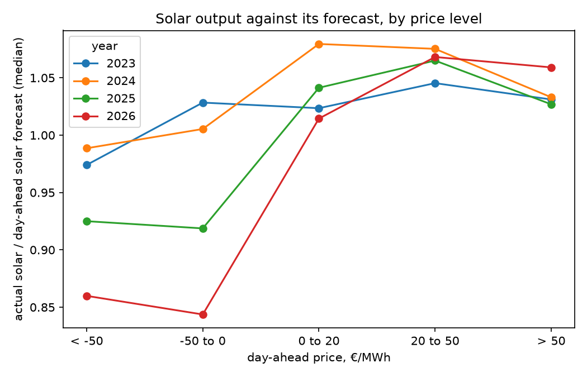
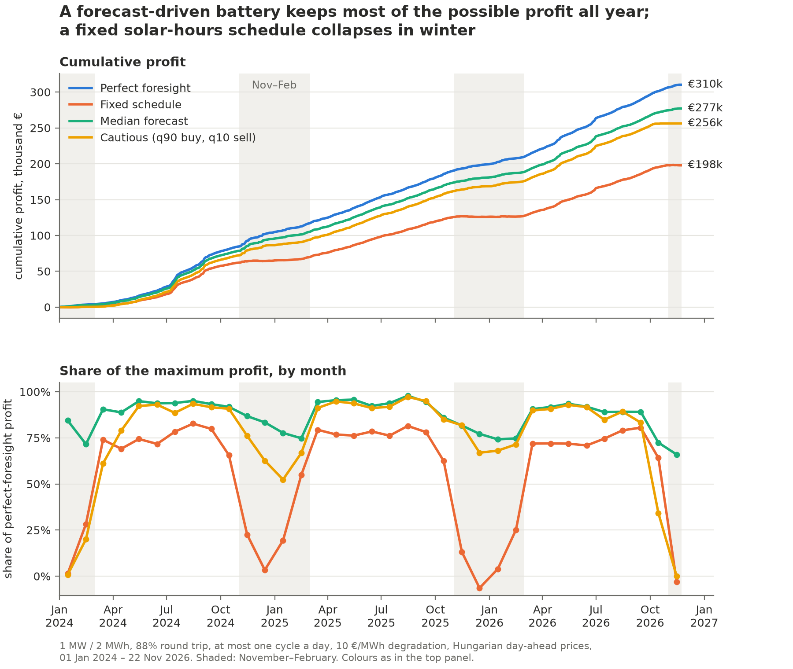

# Negative electricity prices in Hungary

Hungary's day-ahead electricity price was at or below zero for 344 hours in 2025, against ten or fewer a year before 2023. This project asks three questions, using only public data from ENTSO-E and Open-Meteo for 2020 to 2026:

1. Can those periods be predicted the day before, with information available before the 12:00 auction?
2. Did the switch to 15-minute day-ahead prices on 1 October 2025 change them, and do models trained on hourly data still work?
3. What are the forecasts worth to a battery?

Every number below can be rebuilt from scratch with the scripts in `src/`.

## Results

**Negative prices became routine in two years.**

| Year | Hours ≤ 0 €/MWh | Average price (€/MWh) |
| --- | --- | --- |
| 2020–2022 | 1–10 a year | 39–272 |
| 2023 | 93 | 106.8 |
| 2024 | 306 | 100.8 |
| 2025 | 344 | 108.5 |
| 2026, to 21 Nov | 290.5 | 149.0 |

They fall almost entirely between 10:00 and 16:00 and peak in April. The 2024 and 2025 averages match the HUPX annual report (100.81 and 108.51 €/MWh).



**They can be predicted a day ahead.** In a monthly rolling backtest from January 2024 to November 2026 (3.7% of periods at or below zero), logistic regression and a regularised, monotone LightGBM both reach a Brier skill of 0.40 over climatology and a PR-AUC of 0.70–0.72. They are statistically tied (Diebold–Mariano p = 0.95). Yesterday's outcome is worse than climatology. Dropping the ENTSO-E wind and solar forecast, which may be published after the auction, costs nothing.

**The market changed in 2026.** Models trained only on hourly data kept their skill on 15-minute prices for six months, then lost it in summer 2026. Two things moved:

- The residual load (load minus wind and solar) at which the chance of a non-positive price reaches 50% rose from 506 MW in 2023 to 1,199 MW in 2025, then fell to −72 MW in 2026. Prices now need about 1 GW more surplus to go negative.

  

- Solar output at non-positive prices ran 23% below its forecast in 2026, about 224 GWh (95% interval 150–299), against 2% in 2023. At normal prices it runs slightly above the forecast every year, and a placebo between two normal price bands shows no gap. This looks like plants curtailing at zero or negative prices.

  

**A forecast is worth about €75 a day to a 1 MW / 2 MWh battery.** Scheduled on the median price forecast it earns 89% of the perfect-foresight profit; a fixed charge-at-noon, sell-in-the-evening schedule earns 64% and collapses in winter. A cautious strategy that buys at the 90% quantile and sells at the 10% quantile does worse, not better, because forecast errors within a day move together. The ranking holds for 1 to 4 hour batteries, 80–92% efficiency and 0–20 €/MWh degradation cost.



## Running it

Python 3.12 or newer.

```
python -m venv .venv
source .venv/bin/activate        # Windows: .venv\Scripts\Activate.ps1
python -m pip install -r requirements.txt
```

ENTSO-E needs a free token: register at https://transparency.entsoe.eu, email transparency@entsoe.eu with the subject "Restful API access", then generate the token under My Account Settings and set it with `export ENTSOE_API_KEY=...` (PowerShell: `$env:ENTSOE_API_KEY="..."`). Open-Meteo needs no key.

Run the scripts in this order. Each one reads what the previous ones saved.

| Step | Command | What it does | Time |
| --- | --- | --- | --- |
| 1 | `python src/collect_entsoe.py --start 2020-01-01 --only core` | Hungarian prices, load, wind and solar forecasts, generation | 30–60 min |
| 2 | `python src/collect_entsoe.py --start 2020-01-01` | Adds neighbour prices and border flows (optional) | 30–60 min |
| 3 | `python src/collect_weather.py --mode dayahead --start 2024-01-01` | Weather forecasts made the day before, 9 locations | a few min |
| 4 | `python src/first_look.py` | Negative hours per year, heatmap | seconds |
| 5 | `python src/build_dataset.py` | One 15-minute feature table | a minute |
| 6 | `python src/baselines.py` | Climatology, persistence, logistic, LightGBM | a few min |
| 7 | `python src/experiments.py` | Regularised and calibrated LightGBM, RQ2 frozen-model test | a few min |
| 8 | `python src/drift_analysis.py` | Tipping point and solar output against forecast by year | seconds |
| 9 | `python src/curtailment_checks.py` | Matched comparisons, placebo, curtailed GWh, 95% intervals | a few min |
| 10 | `python src/battery.py` | Price quantile forecasts and the battery simulation | 10–20 min |
| 11 | `python src/sensitivity.py` | Battery under seven sets of assumptions | a few min |
| 12 | `python src/robustness.py` | Run without the ENTSO-E forecast, Diebold–Mariano tests | a few min |
| 13 | `python src/make_figures.py` | Paper figures: battery, reliability, heatmap by year, tipping point, solar ratio | a minute |
| 14 | `python src/revision_checks.py` | Control year for RQ2, curtailment with weekend/holiday cells, harder baselines, q30/q70 battery | 15–30 min first time |
| 15 | `python src/neighbour_control.py` | Tipping point holding neighbour prices and net exports fixed (needs step 2) | a few min |

The downloads save one file per month under `data/raw/` and skip what they already have, so an interrupted run can simply be started again. `battery.py --reuse` skips the slow forecasting step when only the battery settings change (`--power`, `--energy`, `--eff`, `--deg`). `revision_checks.py --skip battery` leaves out its slow part; the q30/q70 forecasts are cached after the first run.

## Data notes

- Timestamps are stored in UTC.
- Prices are hourly until 30 September 2025 and 15-minute from 1 October 2025. Before the switch each hourly price is repeated over its four quarters.
- Features must be known before 12:00 the day before delivery. The load forecast is; the wind and solar forecast only has to be published by 18:00, which is why `robustness.py` repeats the main results without it.
- Actual generation and actual load are only used for analysis, never as features.
- The weather features use Open-Meteo's archive of forecasts made one day earlier, available from January 2024, not observed weather.

## Paper

A draft write-up of the methods and results is in progress. Data: [ENTSO-E Transparency Platform](https://transparency.entsoe.eu) and [Open-Meteo](https://open-meteo.com) (CC BY 4.0).